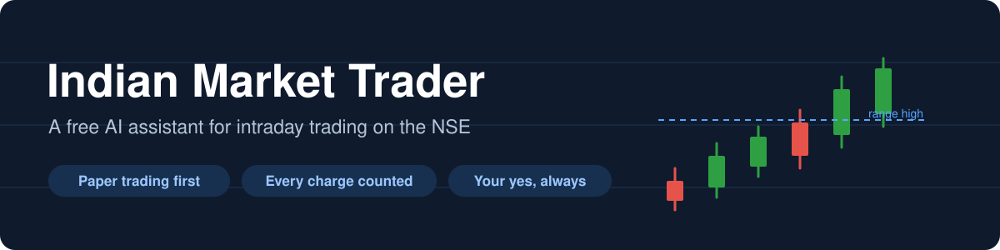
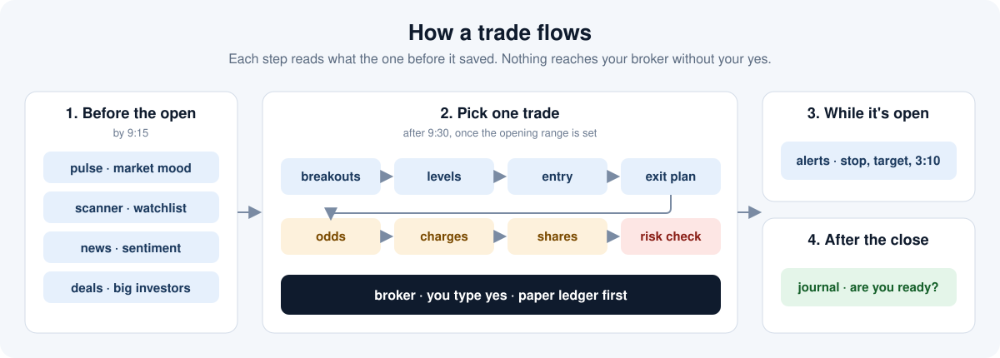
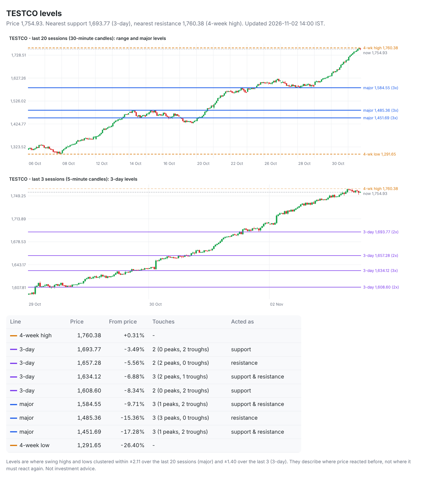

# Indian Market Trader

<p align="center"></p>

**A free AI assistant for intraday trading on the Indian stock market (NSE).**

You ask Claude a question in plain English, Hindi or Hinglish, like *"aaj market kaisa hai?"* or *"show me RELIANCE's levels"*, and it does the homework a careful trader would do: it checks the market, finds stocks that are breaking out, reads the news, works out where to get in and out, counts every rupee of charges, and tells you honestly whether the trade is worth it.

It practises with pretend money (paper trading) by default. **It never places a real order unless you say yes.**

> **Beta.** Checked live on real NSE data from a Mac: the market pulse, the daily and opening-range scans, entry check, exit plan and the Time Machine. Angel One login works on a real account. Placing real orders, the other brokers, and Windows are not tested yet. Start with pretend money. Not investment advice: see [Please read](#please-read).

---

## What it does

- **Morning check:** how the market is doing, which sectors are strong, and whether big investors are buying or selling.
- **Find stocks:** scans the Nifty 500 for stocks breaking out of their morning range.
- **Levels:** draws a clean chart with the few price lines that matter.
- **News and buzz:** results, orders and filings, plus what Reddit is saying, with a warning if it smells like a pump-and-dump.
- **Plan the trade:** when to enter, where to put the stop-loss and target, and how many shares to buy so you can't lose more than your limit.
- **Odds check:** replays the rest of the day 10,000 times to show how often the target or the stop gets hit first.
- **Safety check:** blocks the trade if it breaks your rules (daily loss limit, too many trades, a holiday, a stock under watch, insider rules).
- **Place the order** with your broker, only after you say yes.
- **Journal:** keeps score and tells you when your record is good enough for real money.

## Get started

Three steps: install Python, add the skills to Claude (or ChatGPT), then ask a question.

### Step 1: Install Python (free, one time)

**Mac**
1. Download Python from [python.org/downloads](https://www.python.org/downloads/) and open the installer.
2. When it finishes, open **Applications → Python 3.x** and double-click **Install Certificates.command**. (Without this, the market data downloads fail.)

**Windows**
1. Download Python from [python.org/downloads](https://www.python.org/downloads/) and open the installer.
2. On the first screen, tick **"Add python.exe to PATH"**, then click **Install Now**.
3. Check it worked: open **PowerShell** (Start menu → type "PowerShell") and type `py --version`. You should see a version number.

### Step 2: Add the skills

Pick one:

| Where | How easy | What works |
|---|---|---|
| **A. Claude Code** (recommended) | Easy, a few commands | Everything, including your broker |
| **A2. Claude desktop app** | Easiest, a few clicks | Same plugin, no commands |
| **B. Claude app** (claude.ai or desktop) | Easiest, no commands | Analysis and paper trading. No broker connection |
| **C. ChatGPT or Codex** | Easy | Should work, not tested yet |

#### A. Claude Code (recommended)

Claude Code needs a paid Claude plan (Pro, Max, Team or Enterprise).

1. **Install Claude Code.**
   - **Mac:** open **Terminal** (Applications → Utilities → Terminal) and paste:
     ```
     curl -fsSL https://claude.ai/install.sh | bash
     ```
   - **Windows:** open **PowerShell** and paste:
     ```
     irm https://claude.ai/install.ps1 | iex
     ```
2. **Start it.** Close the window, open a new Terminal (Mac) or PowerShell (Windows), type `claude` and press Enter. The first time, it opens your browser to log in.
3. **Add the skills.** Inside Claude Code, paste these two lines, one at a time:
   ```
   /plugin marketplace add ishankerketta/indian-market-trader
   /plugin install indian-market-trader@indian-market-trader
   ```
4. **Done.** Ask your first question (see Step 3).

#### A2. Claude desktop app (Mac or Windows): no commands needed

1. Open **Settings → Customize → Plugins**.
2. Click **+ Add** (top right) → **Add marketplace**.
3. Paste `ishankerketta/indian-market-trader` and confirm.
4. The plugin **Indian market trader** appears. Add it. It says "installed and ready to use".
5. Open a **New** session and ask: "How's the market looking today?"

Tested on the Mac desktop app.

#### B. Claude app (claude.ai, or the desktop app)

1. **Download the skills:** go to the [latest release](https://github.com/ishankerketta/indian-market-trader/releases/latest) and download the ZIP files. Start with `india-pulse.zip`, `india-scanner.zip`, `india-levels.zip` and `india-charges.zip`, and add more later.
2. **Allow the data:** in Claude, go to **Settings → Capabilities**. Turn on **code execution**, and allow network access to these sites (or to all sites):
   `query1.finance.yahoo.com`, `www.nseindia.com`, `nsearchives.nseindia.com`, `archives.nseindia.com`, `niftyindices.com`, `news.google.com`, `www.reddit.com`
3. **Upload:** go to **Customize → Skills → + → Upload a skill**, and pick a ZIP (don't unzip it). Repeat for each one.

Broker connections need your own computer, so they don't work in the app. Use option A for those.

#### C. ChatGPT or Codex (not tested yet)

The skills use the open `SKILL.md` format, which OpenAI also supports.

- **ChatGPT app** (paid plans): download the ZIPs as in option B, then open **Skills** (in the sidebar or under Plugins) → **Create → Upload from your computer**, and pick a ZIP. ChatGPT may block the market-data downloads. If you see network errors, use Codex or Claude Code instead.
- **Codex** (OpenAI's coding agent): download this project (green **Code** button → **Download ZIP**) and unzip it. Then copy the `skills` folder's contents into your Codex skills folder:
  - **Mac:** `mkdir -p ~/.agents/skills && cp -r skills/* ~/.agents/skills/`
  - **Windows (PowerShell):** `New-Item -ItemType Directory -Force $HOME\.agents\skills; Copy-Item -Recurse skills\* $HOME\.agents\skills\`

If you try it, please [tell us](https://github.com/ishankerketta/indian-market-trader/issues) whether it worked.

### Step 3: Ask

Type in plain English, Hindi or Hinglish:

- "How's the market looking today?"
- "Find breakouts after 9:30"
- "Show me the levels for TCS"
- "Plan a trade in RELIANCE with ₹500 maximum loss"

The first time you plan a trade, Claude asks for your capital, your loss limits and your broker, and saves them. Everything starts in **paper trading** (pretend money).

---

## A typical trading day

| When | What you ask | What happens |
|---|---|---|
| Before 9:15 | "How's the market?" | Market mood, sector leaders, holidays |
| Before 9:15 | "Make my watchlist" | Shortlist of stocks with strong charts |
| After 9:30 | "Any breakouts?" | Stocks breaking their 9:15–9:30 range |
| Picking a trade | "Plan a trade in TCS" | Levels, news, entry, stop, target, odds, shares to buy, safety check |
| You decide | "Yes" | Order placed (pretend money unless you switch it off) |
| During the trade | "Watch it" | Alerts at the stop, the target and 3:10 pm |
| After 3:30 | "How did I do?" | Journal: wins, losses, charges, and whether you're ready for real money |

<p align="center"></p>

## The 15 skills

| Skill | In plain words | Try asking |
|---|---|---|
| `india-pulse` | How's the market today? | "How's the market today?" · "aaj market kaisa hai?" |
| `india-scanner` | Which stocks are breaking out? | "Make my watchlist" · "Any breakouts?" |
| `india-levels` | Where are the important price lines? | "Show me the levels for TCS" · "Levels for NIFTY" |
| `india-news` | What's the news on this stock? | "Any news on RELIANCE?" |
| `india-sentiment` | What's social media saying, and is it a pump? | "What is Reddit saying about ITC?" |
| `india-deals` | Are big investors buying or selling? | "Any bulk deals today?" |
| `india-entry` | Is it time to buy, or too late? | "Is it too late to enter TCS?" |
| `india-exit` | Where should the stop-loss and target go? | "Plan the stop and target for TCS" |
| `india-timemachine` | What are the odds this works today? | "What are the odds on this trade?" |
| `india-charges` | How much will STT, brokerage and GST cost? | "Charges for buying 30 at 300 and selling at 306?" |
| `india-budget` | How many shares should I buy? | "How many shares with ₹500 maximum loss?" |
| `india-risk` | Is this trade allowed by my rules? PASS or BLOCK | "Is this trade allowed?" |
| `india-broker` | Place the order (only after your yes) | "Place it on paper" · "Show my Angel One positions" |
| `india-alerts` | Tell me when the price hits my stop or target | "Alert me at the stop and the target" |
| `india-journal` | How am I doing, and am I ready for real money? | "How am I doing?" |

## Example: one trade, step by step

This is one full trade on **TESTCO**, a made-up company in the test data that ships with the project, so you can see what each step says. The numbers are for illustration only. You ask in plain words and Claude runs the matching step; the output below is what it reads.

Asking **"Show me the levels for TESTCO"** also draws a chart like this and saves it as a web page you can open:

<p align="center"></p>

**1. "Any breakouts?"** (after 9:30)

```
Mon 02 Nov 2026 09:41 IST: 1 of 2 stocks have closed a 5-minute bar beyond their 15-minute opening range (0 fetch errors).
Still above their range now: 1. Fell back inside (breakout failed): 0.
symbol        side      OR low   OR high  trigger trig close  beyond%      last  rvol   day%  status
TESTCO        long     1704.78   1707.31    09:35    1707.63     0.02   1718.72  0.98   0.60  holding
```

How to read it: the opening range is the high and low of 9:15–9:30. A stock is listed when a 5-minute bar *closes* above that range. **holding** means it is still above the range now. **BACK INSIDE the range** means the breakout failed, so skip it. `beyond%` is how far past the range the first close was (tiny means a weak break), and `rvol` is volume compared with a normal day (above 1.5 is unusual interest).

**2. "Is it time to buy TESTCO?"**

```
TESTCO long ORB @ 09:41: TRIGGERED - first 5-minute close above the range at 09:35
  range 1704.78 - 1707.31, last 1718.72 (09:35 bar)
  trigger close 1707.63 at 09:35
```

The answer is one of **waiting**, **triggered** or **expired**. Expired means the price has run more than 1% past the trigger, and Claude will tell you not to chase it.

**3. "Plan the stop and target."**

```
TESTCO LONG plan
  entry     1718.72
  stop      1704.70  (or-low, 14.02/share at risk)
  target    1753.70  (2.5R, 34.98/share)
  flat by 15:10 IST either way
  reward:risk 2.5 gross, 2.09 after ~1.83/share charges
```

**4. "What are the odds?"**

```
Time Machine: TESTCO long from 1718.72 (stop 1704.7, target 1753.7, flat by 15:10)
  10,000 replays of the remaining 67 candles, drawn from 59 past sessions (seed 42):
    today is moving at 0.68x its normal pace for this time of day; replayed candles are scaled to match
    target first 7.5%, stop first 11.1%, still open at flat-by 81.4%
    average result +8.84/share after ~1.83/share charges = +0.63R
  History: the same rule fired on 54 of 59 past sessions: 19 target, 26 stop, 9 neither; average +0.27R net
  Verdict: positive on paper, but 60 sessions is a small sample and the future need not repeat them.
```

It replays the rest of today thousands of times using the stock's own recent candles, scaled to today's pace. If the verdict is negative after charges, it says "skip it", and skipping is a perfectly good result.

**5. "How many shares?"** (with ₹1,00,000 capital and ₹500 maximum loss)

```
Buy 28 TESTCO MIS LIMIT at 1720.5 = ₹48,174.00 (margin ₹48,174.00)
  stop 1704.7: lose about ₹493.32
  target 1753.7: make about ₹877.80 after ₹51.80 charges
  net reward:risk 1.78; flat by 15:10
```

**6. "Is this trade allowed?"**

```
TESTCO-20261102-0941: PASS
  [  ok  ] max loss per trade: ₹493.32 at the stop vs limit ₹500.00
  [  ok  ] daily loss limit: worst case -₹493.32 vs limit -₹1,500.00
  [  ok  ] trades per day: 0 taken today, max 3
  [  ok  ] reward to risk (net): 1.78 vs minimum 1.5
  [  ok  ] entry window: now 09:41, window 09:30-14:30
  [  ok  ] SEBI insider guard: not on your insider list
  [  ok  ] market open today: trading day
  [  ok  ] circuit band: 20.0% band; minimum 10%
  ... and the other checks
```

If any rule fails, the answer is **BLOCK**, with the reason, and the order cannot go further.

**7. "Place it."** Claude shows the order in plain words and waits. On paper (the default) it records the trade in a practice ledger. For a real order you must have switched paper trading off, and you type yes for that exact order.

**8. "What did it cost?"**

```
Buy 28 at 1718.72, sell at 1753.7 (discount brokerage):
  Brokerage                   ₹29.17
  STT (0.025% sell)           ₹12.28
  NSE transaction              ₹2.89
  Stamp duty (buy)             ₹1.44
  GST 18%                      ₹5.81
  Total charges               ₹51.78
  Gross P&L                  ₹979.44
  Net P&L                    ₹927.66
```

**9. "How am I doing?"** After a few weeks of trades, the journal shows your win rate, average win and loss in rupees, charges paid, your worst losing streak, and whether your record is good enough to consider real money.

---

## Connect your broker

| Broker | Works with this pack | Also has its own Claude connector |
|---|---|---|
| **Angel One** | Yes, login tested | No |
| **Dhan** | Yes, not tested yet | Yes, can place orders |
| **Zerodha** | Yes, not tested yet | Yes, GTT orders only |
| **Upstox** | Yes, not tested yet | Yes, view only |
| **FYERS** | Yes, not tested yet | Yes |
| **Groww** | Yes, not tested yet | Yes, buy orders; sells need DDPI |
| **About 40 more** | Through [OpenAlgo](https://github.com/marketcalls/openalgo) | |

This needs option A (Claude Code) on your own computer.

**1. Get the project folder** (one time): on this page, click the green **Code** button → **Download ZIP**, and unzip it. Then open a terminal in that folder:
  - **Mac:** open Terminal, type `cd ` (with a space), drag the unzipped folder into the Terminal window, and press Enter.
  - **Windows:** open the unzipped folder in File Explorer, click the address bar, type `powershell`, and press Enter.

**2. Log in yourself.** Your password and keys never go into the chat:

- **Mac:** `python3 skills/india-broker/connect.py login angelone`
- **Windows:** `py skills\india-broker\connect.py login angelone`

Use `dhan`, `zerodha`, `upstox`, `fyers` or `groww` instead of `angelone` for other brokers. It asks for what your broker needs, and nothing shows on screen while you type secrets. You log in again each trading day.

- **Angel One:** an API key from [smartapi.angelone.in](https://smartapi.angelone.in) (Add App), your client code, your PIN, and the 6-digit code from an authenticator app (set it up under Enable TOTP on the same site).
- **Dhan:** your Client ID and an access token from web.dhan.co → My Profile → DhanHQ Trading APIs.

**3. Check it worked** (this only reads, it can't trade):

- **Mac:** `python3 skills/india-broker/connect.py positions angelone`
- **Windows:** `py skills\india-broker\connect.py positions angelone`

**Static IP for real orders.** Since April 2026, SEBI rules say brokers accept API orders only from an internet address (IP) you've registered with them. Viewing your account works from anywhere. Ask your internet provider for a static IP, or use a small cloud server.

---

## Please read

- **This is not investment advice.** It is software that reads public data and does arithmetic on rules you choose. It is not a SEBI-registered adviser or research analyst.
- **Most intraday traders lose money.** SEBI found about 7 in 10 individual intraday traders lost money in FY2022-23. Practise with pretend money for weeks first, and let the journal judge your record.
- **Nothing happens without your yes.** Real orders need you to switch off paper trading, a fresh safety PASS, and your yes for that exact order.
- **Insider rules.** List any company where you're an insider in your settings (`pit_restricted`), and the pack will always block it.
- **The odds are a simulation, not a promise.** Results days, circuits and big news can move a stock in ways the past never did.
- **A stop-loss can slip.** In a fast market or a circuit, it can fill far from your price, or not at all.
- **The data is free and unofficial.** Yahoo and the NSE website can be late, change or block access. Check anything important in your broker's app.
- **Charges change.** Rates are as of 3 Nov 2026. Compare against one of your real contract notes.
- **Taxes.** Intraday profit is usually taxed as speculative business income at your slab rate. Ask a tax professional.
- **Social media buzz is a warning, not a tip.** Pump-and-dump groups use Telegram and WhatsApp, and late buyers are usually the ones left holding.

---

<details>
<summary><b>For developers: the scripts behind each skill</b></summary>

Every skill is a plain Python script (standard library only). They share a `trader/` folder in your project, and each step reads what the last one wrote.

```
python3 skills/india-pulse/pulse.py                            # pre-market brief
python3 skills/india-scanner/scan.py universe | daily | orb     # Nifty 500, watchlist, breakouts
python3 skills/india-news/news.py --from-scan                  # headlines, filings, move
python3 skills/india-sentiment/sentiment.py --from-scan        # tone, buzz, pump risk
python3 skills/india-levels/levels.py NIFTY                    # levels + chart -> trader/levels_NIFTY.html
python3 skills/india-entry/entry.py check TCS                  # waiting / triggered / expired
python3 skills/india-exit/exit.py plan --stop or-low --target 2R --write
python3 skills/india-timemachine/timemachine.py run --write    # 10,000 replays + history
python3 skills/india-charges/charges.py --buy 300 --sell 306 --qty 30 --compare
python3 skills/india-budget/size.py --write                    # -> trader/orders.json
python3 skills/india-risk/check.py                             # PASS / BLOCK
python3 skills/india-broker/ticket.py show | approve ID --yes | sync | ledger
python3 skills/india-broker/ticket.py preview ID --broker angelone             # shows the exact request, sends nothing
python3 skills/india-broker/ticket.py send ID --broker angelone --live --yes
python3 skills/india-broker/connect.py brokers | status | orders BROKER | positions BROKER
python3 skills/india-alerts/alerts.py add --from-plan ; alerts.py check
python3 skills/india-deals/deals.py bulk | block | insider
python3 skills/india-journal/journal.py
```

- Offline tests (43, on made-up data): `python3 -m unittest discover -s tests -v`
- Check every live data source: `python3 tests/live_check.py RELIANCE`
- Replay a past moment: set `IMT_NOW=2026-11-02T10:15` (and `IMT_DIR=trader-replay` to keep it separate).
- Data sources: Yahoo Finance (`.NS`), NSE archives and website, Google News India, Reddit.
- Known gaps: NSE's live quote and insider-trading pages often refuse scripts, so the pack falls back to NSE's daily files.

</details>

<details>
<summary><b>Similar projects and credits</b></summary>

Inspired by Jake Schincariol's [day-trader-skill](https://github.com/Jakeschincariol/day-trader-skill) for US markets (MIT). This is an independent rewrite for NSE.

Ideas re-implemented here, with thanks:
- [claude-trading-skills-india](https://github.com/Shubhamkumartrichy/claude-trading-skills-india) (MIT): broker brokerage profiles, market pulse, broker connector table.
- [nse-day-trader-skill](https://github.com/parinshahAIbuilder/nse-day-trader-skill) (MIT): SEBI insider guard, holiday calendar, ASM/GSM and circuit checks.
- [nse-trader-skills](https://github.com/Vatsa10/nse-trader-skills) (MIT): the idea of a live data check.
- [OpenAlgo](https://github.com/marketcalls/openalgo) (AGPL-3.0): an optional adapter calls its API. None of its code is included.
- Also worth a look: [Tapetide NSE/BSE MCP](https://github.com/Tapetide-hq/nse-bse-indian-stock-market-data-mcp) for fundamentals, and other India ports: [indian-day-trader](https://github.com/iamsanaur/indian-day-trader), [day-trader-skill-india](https://github.com/bhardwajaditya/day-trader-skill-india), [day-trader-india](https://github.com/Fantastic792/day-trader-india).

</details>

**Coming next:** testing each broker with real accounts, Windows testing, checking charges against real contract notes, and results summaries from NSE filings.

Found a problem? [Open an issue](https://github.com/ishankerketta/indian-market-trader/issues) and paste what you saw (remove any personal details).

MIT licence. Made by [Ishan Savio Kerketta](https://ishansavio.com).
